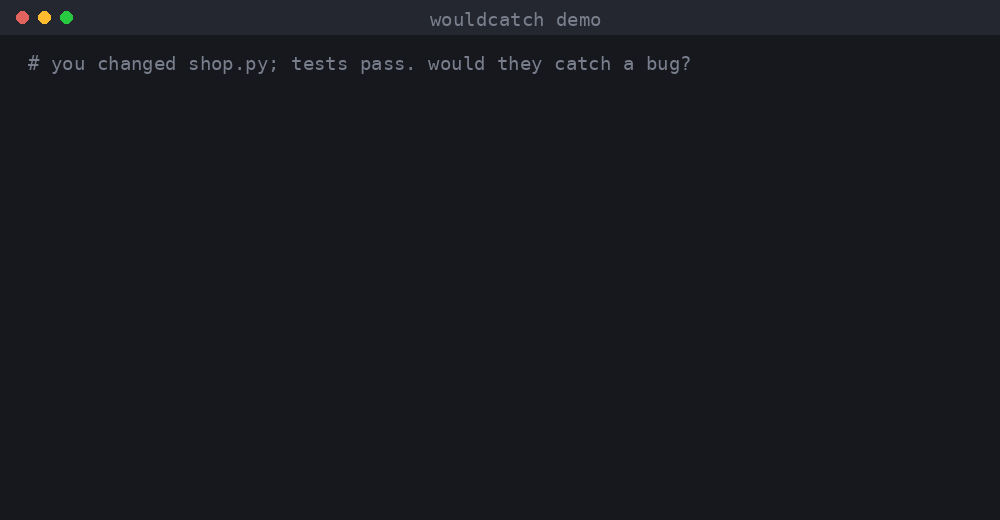

<h1 align="center">wouldcatch</h1>

<p align="center">
  <b>Your tests pass. Would they catch a bug?</b><br>
  wouldcatch plants small bugs in the lines you just changed, runs your tests, and shows the ones nobody noticed.
</p>

<p align="center">
  <a href="https://github.com/Sahil-u07/wouldcatch/actions/workflows/ci.yml"></a>
  
  
  <a href="LICENSE"></a>
</p>

<p align="center">
  
</p>

```bash
pipx install git+https://github.com/Sahil-u07/wouldcatch
cd your-repo && wouldcatch
```

No config. No dependencies. Works on any git repo with pytest (or any test command).

## Green tests can still miss bugs

You add a member discount and write two tests. Every line runs. Everything passes.

```python
def discount(price, is_member):
    if is_member and price >= 100:
        return price - 10
    return price

def test_member():
    assert discount(200, True) == 190

def test_guest():
    assert discount(50, False) == 50
```

```
$ wouldcatch
  MISSED  shop.py:2  `and` -> `or`
  MISSED  shop.py:2  `>=` -> `>`
  MISSED  shop.py:2  `100` -> `101`

4/7 caught. 3 bug(s) your tests would not notice.
```

Each MISSED line is a bug someone could ship and your suite would stay green:

- `>=` becoming `>` means a member spending exactly 100 gets no discount. No test checks 100.
- `and` becoming `or` gives every guest over 100 the discount. No test has a guest over 100.

Add `assert discount(100, True) == 90` and `assert discount(200, False) == 200`, run it again, and you get `7/7 caught`.

Coverage can't tell you this. It counts which lines ran, not whether a test would fail if they were wrong.

## Why only the diff

Mutation testing is the honest way to grade a test suite, but running it on a whole project can take hours, so almost nobody does. wouldcatch only mutates the lines in your `git diff`. A normal change gives 5 to 30 mutants, so it finishes while you're still writing the commit message.

| | Line coverage | Whole-project mutation testing | **wouldcatch** |
|---|---|---|---|
| Tells you a test would fail on a bug | no | yes | **yes** |
| Time on a typical change | seconds | minutes to hours | **seconds to a few minutes** |
| Setup | plugin | config files | **none** |
| Output | a percentage | a report on everything | **the exact lines to test** |

## How it works

1. Reads `git diff` to find the Python lines you changed. Test files are skipped.
2. Makes one small change at a time on those lines: `<` to `<=`, `==` to `!=`, `and` to `or`, `+` to `-`, `True` to `False`, `100` to `101`, a return value to `None`, an `if` flipped.
3. Runs your tests after each change. Tests still green means that bug would have gotten through.
4. Puts the file back byte for byte (CRLF included) after every run, even on Ctrl+C or a killed process.

## Usage

```bash
wouldcatch                                  # uncommitted changes, or the last commit if the tree is clean
wouldcatch --base main                      # everything on this branch since main
wouldcatch --cmd "pytest tests/unit -x -q"  # run only the tests that matter
wouldcatch --json                           # machine-readable output for scripts and agents
wouldcatch --all                            # list caught mutants too
wouldcatch --max 100                        # try more mutants (default 50)
```

Exit codes: `0` all caught, `1` something missed, `2` setup problem (not a git repo, tests already failing).

Skip a line on purpose:

```python
RETRY_DELAY = 5  # wouldcatch: ignore
```

## Use it everywhere

**GitHub Actions**, on every pull request:

```yaml
- uses: actions/checkout@v5
  with:
    fetch-depth: 0
- run: pip install git+https://github.com/Sahil-u07/wouldcatch pytest
- run: wouldcatch --base origin/${{ github.base_ref }}
```

**pre-commit**, before every commit (with wouldcatch installed in your project environment):

```yaml
- repo: https://github.com/Sahil-u07/wouldcatch
  rev: main
  hooks:
    - id: wouldcatch
```

**AI coding agents.** Agents are good at writing tests that pass and bad at writing tests that check anything. wouldcatch gives them a concrete target: make every MISSED line fail.

- Claude Code: copy [`skills/wouldcatch`](skills/wouldcatch) into `.claude/skills/` in your project.
- Any other agent: add this to `AGENTS.md`:

```
After changing Python code, run `wouldcatch --json`. For every mutant with
"status": "missed", add a test that fails for that change. Re-run until none are missed.
Never change the source code to make a mutant go away.
```

## FAQ

**Will it mess up my files?** It edits one file at a time and restores it right after. If the process dies mid-run, the next run restores the file from `.wouldcatch-backup.json` before doing anything else.

**My test suite is slow.** Each mutant is one run of your test command. Point `--cmd` at the relevant tests and use `-x` so pytest stops at the first failure.

**A mutant can't be caught, the code really doesn't care.** That happens (a log interval, a cache size). Mark the line `# wouldcatch: ignore`.

**JavaScript, TypeScript, Go?** Python today. The git part is language-neutral; JS/TS is next. Join [the discussion](https://github.com/Sahil-u07/wouldcatch/issues/4).

## Contributing

New mutations are small, self-contained PRs. Start with a [good first issue](https://github.com/Sahil-u07/wouldcatch/labels/good%20first%20issue) and see [CONTRIBUTING.md](CONTRIBUTING.md).

If wouldcatch found a bug your tests missed, a star helps other people find it.

## License

[MIT](LICENSE)
