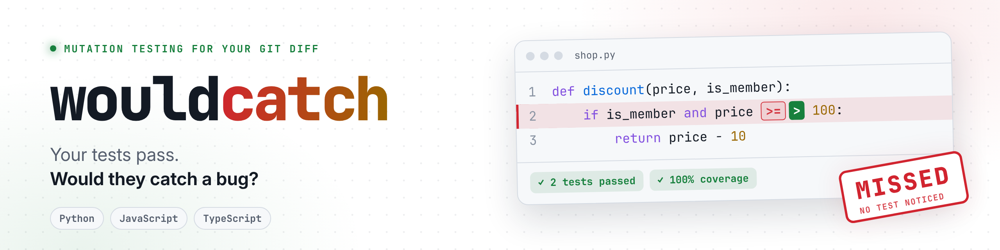

<p align="center">
  <picture>
    <source media="(prefers-color-scheme: dark)" srcset="docs/banner-dark.png">
    
  </picture>
</p>

<p align="center">
  <a href="https://github.com/Sahil-u07/wouldcatch/actions/workflows/ci.yml"></a>
  <a href="https://pypi.org/project/wouldcatch/"></a>
  <a href="https://github.com/marketplace/actions/wouldcatch"></a>
  
  
  
  <a href="LICENSE"></a>
</p>

<p align="center">
  <a href="#quick-start">Quick start</a> ·
  <a href="#the-problem">The problem</a> ·
  <a href="#on-a-real-project">On a real project</a> ·
  <a href="#what-it-mutates">What it mutates</a> ·
  <a href="#ci-pre-commit-and-ai-agents">CI and agents</a> ·
  <a href="#faq">FAQ</a>
</p>

<br>

wouldcatch plants small bugs in **only the lines you just changed**, runs your tests after each one, and tells you which bugs got through. If your tests stay green when the code is wrong, you'll know the exact line.

Works on **Python, JavaScript and TypeScript**, on Windows, macOS and Linux.

<p align="center">
  
</p>

## Quick start

| | Python | JavaScript / TypeScript |
|---|---|---|
| Install | `pipx install wouldcatch` | `pipx install "wouldcatch[js]"` |
| Run | `wouldcatch` | `wouldcatch` |
| Tests it runs | `pytest`, with your project's Python | your `package.json` test script (npm, pnpm, yarn or bun, picked from the lockfile) |
| Files | `.py` | `.js` `.jsx` `.mjs` `.cjs` `.ts` `.tsx` `.mts` `.cts` |

No pipx? `pip install wouldcatch` works too (`py -m pip install wouldcatch` on Windows).

That's it. No config file and no plugin. It reads your `git diff`, runs your tests, and puts every file back exactly as it was. Any test runner works (pytest, Jest, Vitest, Mocha, `node --test`), because all it needs is a command that fails when a test fails: `wouldcatch --cmd "your test command"`.

The Python core has zero dependencies. The `[js]` extra adds the [tree-sitter](https://tree-sitter.github.io/) parser.

## The problem

Two tests. Every line runs. Everything is green.

```python
def discount(price, is_member):              def test_member():
    if is_member and price >= 100:               assert discount(200, True) == 190
        return price - 10
    return price                             def test_guest():
                                                 assert discount(50, False) == 50
```

```console
$ wouldcatch
  MISSED  shop.py:2  `and` -> `or`
  MISSED  shop.py:2  `>=` -> `>`
  MISSED  shop.py:2  `100` -> `101`

4/7 caught. 3 bug(s) your tests would not notice.
```

| Mutant | The bug it stands for | Why the tests missed it |
|---|---|---|
| `>=` -> `>` | A member spending exactly 100 gets no discount | No test checks 100 |
| `100` -> `101` | Same boundary, shifted by one | No test checks 100 |
| `and` -> `or` | Every guest over 100 gets the discount | No test has a guest over 100 |

Add two asserts, `discount(100, True) == 90` and `discount(200, False) == 200`, and it's `7/7 caught`.

<details>
<summary><b>The same thing in JavaScript</b></summary>

```js
export function shipping(total, isPrime) {       test('prime ships free', () =>
  if (isPrime || total >= 50) {                    assert.strictEqual(shipping(80, true), 0));
    return 0;
  }                                              test('small orders pay', () =>
  return 5;                                        assert.strictEqual(shipping(20, false), 5));
}
```

```console
$ wouldcatch
  MISSED  cart.mjs:2  `||` -> `&&`
  MISSED  cart.mjs:2  `>=` -> `>`
  MISSED  cart.mjs:2  `50` -> `51`

3/6 caught. 3 bug(s) your tests would not notice.
```

No test has a non-Prime order over 50 or an order of exactly 50, so free shipping for regular customers could break and nothing would fail.
</details>

> **Coverage said 100%.** Coverage counts which lines ran. It can't tell you whether any test would fail if those lines were wrong. That's the question wouldcatch answers.

## On a real project

Run against [click](https://github.com/pallets/click), on a pager refactor ([9835b0f](https://github.com/pallets/click/commit/9835b0f)), wouldcatch flagged this line:

```python
if os.environ.get("TERM") in ("dumb", "emacs"):
    return _nullpager(stdout, color)
```

No test in click sets `TERM` to `dumb` or `emacs`. The rule that turns the pager off in dumb terminals and Emacs could be deleted and every test would still pass. It's a small gap in a well-tested library, and a coverage report shows it as green.

Try it on any repo's history yourself: `wouldcatch --base <commit>^` after checking out a commit, or run [`scripts/try_real_prs.py`](scripts/try_real_prs.py).

## Why only the diff

Mutation testing is the honest way to grade tests, but running it across a whole project takes long enough that almost nobody does. wouldcatch only touches the lines in your diff. A normal change gives 5 to 30 mutants, so it's done before you finish the commit message.

| | Line coverage | Whole-project mutation testing | **wouldcatch** |
|---|:---:|:---:|:---:|
| Tells you a test would fail on a bug | no | yes | **yes** |
| Time on a typical change | seconds | minutes to hours | **seconds to minutes** |
| Setup | plugin | config files | **none** |
| Output | a percentage | a report on everything | **the exact lines to test** |

## What it mutates

One change at a time, only on lines in your diff. Test files are never mutated.

| Kind | Python | JavaScript / TypeScript | Catches tests that never check... |
|---|---|---|---|
| Comparison | `<` -> `<=`, `==` -> `!=`, `in` -> `not in` | `<` -> `<=`, `===` -> `!==` | boundaries and equality |
| Arithmetic | `+` -> `-`, `*` -> `/`, `//` -> `/`, `%` -> `*`, `**` -> `*` | `+` -> `-`, `*` -> `/`, `%` -> `*`, `**` -> `*` | the actual computed value |
| Assignment | `+=` -> `-=` | `+=` -> `-=` | running totals |
| Logic | `and` -> `or`, `not x` -> `x` | `&&` -> `\|\|`, `!x` -> `x` | each side of a condition |
| Constants | `True` -> `False`, `100` -> `101` | `true` -> `false`, `100` -> `101` | exact values and limits |
| Returns | `return x` -> `return None` | `return x` -> `return undefined` (JS only) | the return value at all |
| Calls | `max(a, b)` -> `min(a, b)` | `Math.max` -> `Math.min` | which of two values wins |
| Loops | `break` -> `continue` | `break` -> `continue` | how a loop ends early |
| Branches | `if cond:` -> `if not (cond):` | `if (cond)` -> `if (!(cond))` | both paths of an `if` or `while` |

Code is read with a real parser (Python's own `ast` and tokenizer, tree-sitter for JS/TS), so an operator inside a string, comment, regex, template literal, type annotation, generic or JSX tag is never touched. Every mutant is re-parsed before it's tried, and ones that would be syntax errors are dropped.

Want another one? New mutations are small PRs: see the [good first issues](https://github.com/Sahil-u07/wouldcatch/labels/good%20first%20issue).

## Usage

| Command | What it does |
|---|---|
| `wouldcatch` | Uncommitted changes; on a clean feature branch, everything since it left `main`; otherwise the last commit |
| `wouldcatch --base main` | Everything on this branch since `main` |
| `wouldcatch --cmd "pytest tests/unit -x -q"` | Use your own test command |
| `wouldcatch --json` | Machine-readable output for scripts and agents |
| `wouldcatch --all` | Show caught mutants too |
| `wouldcatch --github` | Also print GitHub annotations (automatic inside GitHub Actions) |
| `wouldcatch --max 100` | Try more mutants (default 50) |

Exit codes: `0` nothing missed · `1` something missed · `2` setup problem (not a git repo, tests already failing) · `3` incomplete: `--max` left mutants untried (pass `--allow-partial` to accept that).

A mutant whose test run times out is reported as `timeout`, separately from caught: a hang isn't proof that a test checks that line.

Skip a line on purpose with a comment on that line: `# wouldcatch: ignore` in Python, `// wouldcatch: ignore` in JavaScript and TypeScript.

If your tests already fail before any mutant is tried, wouldcatch stops and shows the end of the test output so you can see why.

## CI, pre-commit and AI agents

<details open>
<summary><b>GitHub Action</b>: missed bugs show up on the exact lines of the pull request</summary>

```yaml
on: pull_request
jobs:
  wouldcatch:
    runs-on: ubuntu-latest
    steps:
      - uses: actions/checkout@v5
        with:
          fetch-depth: 0
      - uses: actions/setup-python@v6
        with:
          python-version: "3.13"
      - run: pip install -e . pytest   # your project and its test deps
      - uses: Sahil-u07/wouldcatch@v0.3.1
```

For a JavaScript or TypeScript project, swap the Python install line for your own setup (`actions/setup-node`, then `npm ci`). The Action still needs `setup-python`, since wouldcatch itself runs on Python.

Inputs (all optional): `cmd` (test command), `base` (defaults to the PR's base branch), `max` (default 50), `allow-partial` (default `false`), `fail-on-missed` (default `true`).
</details>

<details>
<summary><b>pre-commit</b>: check before every commit</summary>

With wouldcatch installed in your project environment:

```yaml
- repo: https://github.com/Sahil-u07/wouldcatch
  rev: v0.3.1
  hooks:
    - id: wouldcatch
```
</details>

<details>
<summary><b>AI coding agents</b>: make them write tests that check something</summary>

Agents are good at writing tests that pass and bad at writing tests that would fail on a bug. The MISSED list gives them a concrete target.

**Claude Code:** copy [`skills/wouldcatch`](skills/wouldcatch) into `.claude/skills/` in your project.

**Any other agent:** add this to `AGENTS.md`:

```
After changing Python, JavaScript or TypeScript code, run `wouldcatch --json`. For every mutant with
"status": "missed", add a test that fails for that change. Re-run until none are missed.
Never change the source code to make a mutant go away.
```
</details>

## How it works

```
git diff ──> changed lines ──> mutants ──> run tests per mutant ──> restore file ──> report
```

1. `git diff` gives the Python, JavaScript and TypeScript lines you changed.
2. Each mutant is a tiny text edit at an exact position, so your formatting and comments stay untouched.
3. Your test command runs once per mutant. A fresh bytecode cache each run means a stale `.pyc` can never hide a mutant.
4. The file is restored byte for byte (CRLF included) after every run, even on Ctrl+C. If the process is killed, the next run restores it from a backup kept inside `.git` first.

## FAQ

<details>
<summary><b>Isn't this what mutmut or pytestmut already do?</b></summary>

Partly, and they're good tools. mutmut and cosmic-ray mutate the whole project, which is a thorough audit. [pytestmut](https://pytestmut.readthedocs.io/) also has a diff mode (`--diff`, `--staged`) and parallel workers, so if you need speed on a big suite, try it. Diff-based mutation testing isn't new in other languages either: [Infection](https://infection.github.io/guide/how-to.html) (PHP) and [Mull](https://mull.readthedocs.io/) (C/C++) both do it.

wouldcatch aims at one workflow: zero config, run it on the change in front of you, get exact lines back. That includes warnings on the pull request diff through the GitHub Action, and a `--json` list an AI agent can turn into tests.
</details>

<details>
<summary><b>Will it mess up my files?</b></summary>

It edits one file at a time and restores it right after, byte for byte. If the process dies mid-run, the next run restores the file from a backup kept inside `.git` before doing anything else.
</details>

<details>
<summary><b>My test suite is slow.</b></summary>

Each mutant is one run of your test command. Point `--cmd` at the relevant tests and add `-x` so pytest stops at the first failure.
</details>

<details>
<summary><b>A mutant can't be caught because the code really doesn't care.</b></summary>

That happens (a log interval, a cache size). Mark the line `# wouldcatch: ignore`.
</details>

<details>
<summary><b>Which languages?</b></summary>

Python out of the box. JavaScript and TypeScript with `pip install "wouldcatch[js]"`, which adds the tree-sitter parser. A repo with both gets both checked in one run.

Two limits on the JS/TS side for now: the default command needs a `package.json` at the repo root (in a monorepo, pass `--cmd`), and if your test runner type-checks (ts-jest does), a mutant that only breaks the types counts as caught.
</details>

## Contributing

PRs welcome, especially new mutations. Start with a [good first issue](https://github.com/Sahil-u07/wouldcatch/labels/good%20first%20issue) and read [CONTRIBUTING.md](CONTRIBUTING.md).

<p align="center">
  <br>
  <b>If wouldcatch found a bug your tests missed, a star helps other people find it.</b>
  <br><br>
  <a href="LICENSE">MIT</a> · made by <a href="https://github.com/Sahil-u07">Sahil Lenka</a>
</p>
